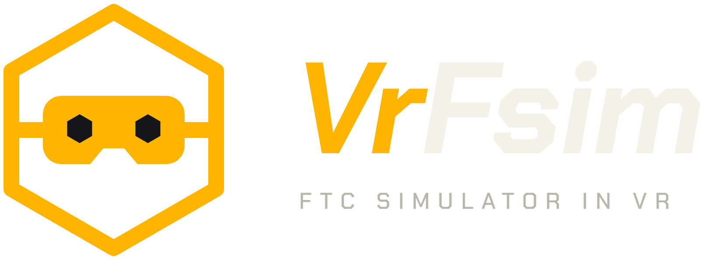

# VrFsim Controller Connect

<p align="center"></p>

**For laptops that can't run Quest Link.** [VrFsim](https://github.com/guyka2212/biobuzz-vr-sim)
(an FTC BIOBUZZ driving simulator) can run standalone on a Meta Quest. Controller Connect lets you
drive it with a controller plugged into your laptop: the controller's input goes to the headset over
the headset's USB-C cable. It replaces a USB-A → USB-C adapter on the headset, and the cable charges
the headset while you play.

> **Not the recommended way to play.** If your PC meets the requirements for Quest Link or SteamVR,
> install the normal [VrFsim PC version](https://github.com/guyka2212/biobuzz-vr-sim#installing)
> instead. Controller Connect is only for PCs below the minimum requirements.

## What you need

- A Meta Quest (3, 3S, Pro or 2) with **developer mode** on (Meta Horizon phone app → Devices →
  Headset settings → Developer mode).
- **VrFsim installed on the headset**, using *VrFsim Quest Setup* (`VrFsim-Quest-Setup.exe`) from the
  [VrFsim releases](https://github.com/guyka2212/biobuzz-vr-sim/releases).
- A USB-C cable from the headset to the laptop.
- Any controller: Xbox (XInput); PlayStation, Logitech, Switch Pro and other pads that Windows lists
  under *Game controllers*.
- Windows 10 or 11. Nothing else: it runs on the .NET Framework that ships with Windows.

## Install and use

1. Download **VrFsim-Controller-Connect-Setup.exe** from the
   [Releases page](https://github.com/guyka2212/controller-connect/releases) and run it. Windows
   may show *"Windows protected your PC"* because it is not code-signed: **More info → Run anyway**.
   It installs for your user only (no admin), with desktop and Start menu shortcuts.
2. Connect the headset with the USB-C cable. In the headset, accept **Allow USB debugging** (tick
   *Always allow from this computer*).
3. The first time only: click **Download Android tools from Google**. Controller Connect uses
   Google's `adb` to talk to the headset. It is not bundled (Google's license); it is downloaded
   once into `%LOCALAPPDATA%\VrFsim` (shared with VrFsim Quest Setup). An `adb` already on your PC
   (Android SDK, Unity) is used if present.
4. Click **Start VrFsim on the headset**.
5. Plug the controller into the laptop and pick it in the list. Put the headset on. The **Link**
   line turns green, and the game's *Menu → Controls* says *connected*.

Keep Controller Connect open while you play. Gamepads paired to the headset by Bluetooth and the
Quest Touch controllers keep working at the same time.

Uninstall: Windows **Settings → Apps → Installed apps → VrFsim Controller Connect → Uninstall**.

## Controller mapping

| Controller | How it is read | Mapping |
|---|---|---|
| Xbox / XInput | XInput | as printed on the pad |
| PlayStation, Logitech (D mode), Switch Pro, others | Windows joystick API | common DirectInput order: 1 X/□, 2 A/✕, 3 B/○, 4 Y/△, 5 LB/L1, 6 RB/R1, 7 LT/L2, 8 RT/R2, 9 Back/Share, 10 Start/Options, 11 LS, 12 RS; left stick X/Y, right stick Z/R, D-pad on the hat |

Anything that lands on the wrong button can be rebound in VrFsim's *Menu → Controls*.

## How it works

The game listens on a loopback port on the headset. Controller Connect runs
`adb forward tcp:47812 tcp:47812` over the USB cable, connects, and sends the controller state about
120 times a second (and at least every 100 ms). In the game it becomes a normal gamepad. See
[PROTOCOL.md](PROTOCOL.md). Nothing is sent over the network.

## Build from source

Run `./build.sh` in Git Bash. It uses only the .NET Framework C# compiler and PowerShell that ship
with Windows and writes `dist/ControllerConnect.exe` and `dist/VrFsim-Controller-Connect-Setup.exe`.
The version is in `VERSION`.

```
src/         Program, Controllers (XInput + joystick), Adb, Bridge (the link), MainForm (the window)
installer/   one-file installer (shared with VrFsim's installer) and the Windows manifest
assets/      icon and logo
```

For testing without a headset, `ControllerConnect.exe /direct` connects straight to
`127.0.0.1:47812`.

*FIRST*, FTC, BIOBUZZ, Meta and Quest are trademarks of their owners. Independent fan project.
